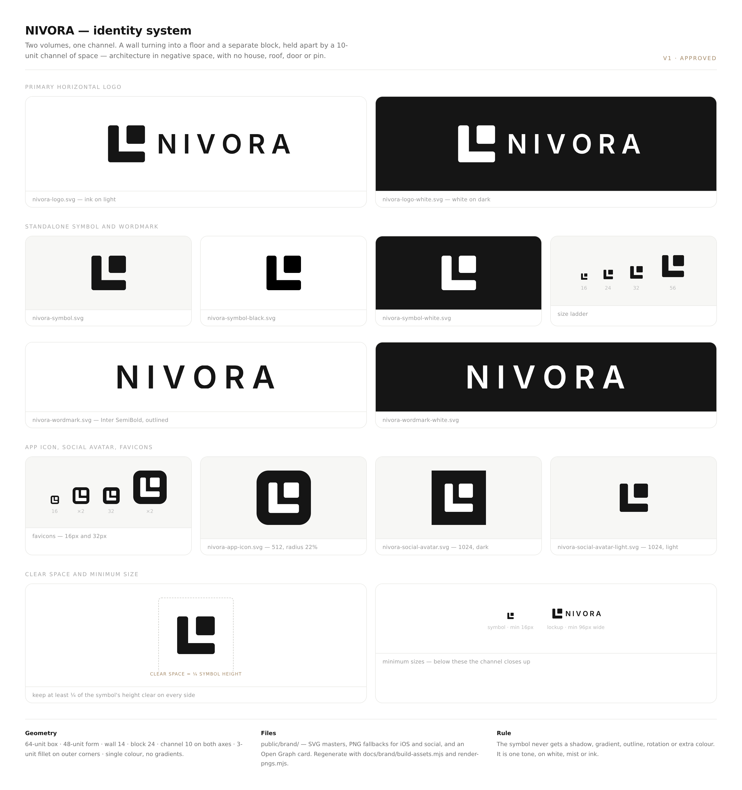

# NIVORA — brand identity

The shipped identity, the reasoning behind it, and the rules that keep it intact.



---

## 1. The mark

**Two volumes, one channel.**

A vertical wall turns into a floor. A separate block sits above and to its right,
flush with the top and right edges of the same 48-unit square. The two are held
apart by a channel of space that runs in from the top edge, turns at a right
angle and exits through the right edge.

That is the whole idea. It is architectural in origin — planes meeting, a wall
becoming a floor, mass opening to space — and abstract in reading. It is
deliberately **not** a house, a roof, a doorway or a location pin: no triangle
roof, no arch, no pin taper, no door cut. The negative space is the subject, not
a hole cut in the silhouette of a building.

The channel is the reason the mark works. Because both forms are inscribed in the
same square, the gap is identical on both axes *by construction* — 10 units wide
vertically, 10 units wide horizontally, with no fiddling. At 16px it still reads
as two shapes with air between them; at 400px it reads as architecture.

### Geometry

| Property | Value |
| --- | --- |
| Canvas | `viewBox="0 0 64 64"` |
| Form | 48 × 48, inset 8 units on every side |
| Wall / floor thickness | 14 units |
| Block | 24 × 24, flush to top and right edges |
| Channel | 10 units — identical on both axes |
| Corner treatment | 3-unit fillet on outer corners; the concave corner stays sharp |
| Colour | one flat tone; `currentColor` in component use |
| Paths | two, one per volume — no strokes, no masks, no effects |

The 8-unit inset is the symbol's built-in optical margin. It is why the mark sits
comfortably inside a tile without extra padding, and it means the symbol is
already correctly spaced whenever it is used alone.

Generated by `geometry.mjs`; nothing is hand-typed. The two paths in every
shipped file come from that module, so the form cannot drift between assets.

---

## 2. Wordmark

The name is set in **Inter SemiBold (wght 600)** with **0.22em** tracking, and
**outlined to paths**. No shipped asset depends on a font being installed, and no
asset can reflow if Inter fails to load — the lockup renders identically in the
header, in a favicon and in a PNG.

- Cap height is the wordmark's own bounding box, so `nivora-wordmark.svg` is
  pure ink with no padding.
- Trailing tracking is trimmed; the wordmark ends where the last `A` ends.

---

## 3. Horizontal lockup

Symbol and wordmark, locked: the symbol's 64-unit box at full height, an 18-unit
optical gap from the symbol's ink edge, and a wordmark whose cap height is
**1/1.9 of the symbol's ink height** (ratio 1.9:1).

The ratio matters more than the absolute size: it is what keeps the symbol
reading as the primary mark and the wordmark as its label. In the site header the
lockup renders at 36px tall (122px wide), which puts the wordmark at a 14px cap
height against 15px navigation text.

The lockup is one SVG (`nivora-logo.svg`) and one React component; there is no
CSS gap, no font-size and no letter-spacing to get out of sync.

---

## 4. Colour

The identity is monochrome. There is no tinted logo, no gradient, no duotone.

| Asset variant | Colour | Use |
| --- | --- | --- |
| `ink` (`#151515`) | brand ink | light backgrounds — the default |
| `white` (`#FFFFFF`) | white | ink, coal (`#171717`) and photography |
| `black` (`#000000`) | pure black | print, stamps, single-colour reproduction |

Tiles (favicon, app icon, social) are ink with a white mark. On a light tile the
mark is ink.

---

## 5. Files

All in `public/brand/`. SVG is the master; PNG exists only where a platform
cannot use SVG.

| File | What it is |
| --- | --- |
| `nivora-logo.svg` | primary horizontal lockup, ink |
| `nivora-logo-white.svg` | primary lockup, white |
| `nivora-logo-black.svg` | primary lockup, pure black |
| `nivora-symbol.svg` | standalone symbol, ink |
| `nivora-symbol-white.svg` | standalone symbol, white |
| `nivora-symbol-black.svg` | standalone symbol, pure black |
| `nivora-wordmark.svg` | wordmark alone, ink |
| `nivora-wordmark-white.svg` | wordmark alone, white |
| `nivora-wordmark-black.svg` | wordmark alone, pure black |
| `nivora-favicon.svg` | 32px favicon tile |
| `nivora-favicon-16.svg` | 16px favicon tile (tighter optical margin) |
| `favicon-16.png`, `favicon-32.png` | favicon fallbacks |
| `nivora-app-icon.svg` | 512px app icon, 22% corner radius |
| `apple-touch-icon.png` | 180px — iOS ignores SVG |
| `icon-192.png`, `icon-512.png` | PWA install sizes |
| `nivora-social-avatar.svg` | 1024px social profile icon, dark |
| `nivora-social-avatar-light.svg` | 1024px, light |
| `social-avatar-1024.png` | social profile PNG |
| `nivora-og.png` | 1200 × 630 Open Graph card |

The favicon deliberately uses a **larger optical ink ratio at 16px** (0.66) than
at 32px (0.58): at 16px the form needs less margin to hold its own. The form
itself is identical — only the size inside the tile changes.

### Regenerating

```bash
npm install --no-save fontkit @sparticuz/chromium puppeteer-core
node docs/brand/build-assets.mjs        # SVGs + src/components/brand/mark-paths.generated.ts
node docs/brand/render-pngs.mjs         # PNG fallbacks + Open Graph card
node docs/brand/build-signoff.mjs       # logo-size-test.html / .png
node docs/brand/build-system-sheet.mjs  # logo-system.png
```

`build-assets.mjs` also writes the TypeScript module the site imports, so the
header renders the same geometry as the files. It refuses to write an asset with
an unresolved fill.

---

## 6. Rules

**Clear space** — at least ¼ of the symbol's height on every side. The symbol's
own 8-unit inset counts toward this.

**Minimum sizes** — symbol 16px; horizontal lockup 96px wide. Below that the
channel closes up and the mark becomes a blob.

**Do**

- Keep it one tone, flat, on white, mist (`#F7F7F5`) or ink.
- Use the standalone symbol where the name is already present.
- Use the horizontal lockup everywhere the brand appears for the first time.

**Do not**

- Add shadows, glows, gradients, outlines, bevels or extra colours.
- Rotate, skew, stretch, or re-space the lockup.
- Re-cut the channel or change the arm/block ratio — the 10-unit channel is the
  mark's signature.
- Place the ink mark on a mid-tone or on busy photography; use the white variant
  there.
- Substitute a different typeface for the wordmark.

---

## 7. Decision log

### Concept stage (see `concepts/`)

Three directions were developed and compared at 16 / 40 / 96px:

| | Direction | Verdict |
| --- | --- | --- |
| A | Architectural N — a monogram whose diagonal rises into a roofline | Refined the *old* mark; lowest distinctiveness. Rejected. |
| B | Abstract doorway — a slab with an off-centre arched threshold | Highest distinctiveness at small sizes. **Selected** — then developed further, because the arch still read as a door. |
| C | Plan boundary with a diagonal passage | Collapsed at 16px (read as “Z” or “2”). Rejected. |

### Form stage

Concept B's arched threshold was replaced in this pass: an arch is a doorway, and
a doorway was explicitly out. Six geometric families were tested at 16 / 40 / 96px
— offset masses, corner-and-block, route-through-mass, stepped field, diagonal
void, nested aperture. Four collapsed or read as generic icon-library marks. The
survivor was the two-volume form, then refined through:

- **Proportion sweeps** — arm/block pairs of 12/26, 14/24, 15/24, 16/22. 14/24
  with a 10-unit channel was the most balanced: enough arm to read as a wall,
  enough block to read as mass, enough gap to survive 16px.
- **Corner treatment** — sharp, 3-unit fillet, and a 45° mitre on the concave
  corner. The mitre was rejected: it is only ~2px at 16px, so the gesture
  disappears exactly where the mark is seen most.

**Approved: the 3-unit fillet.** The user signed off this specific treatment
(`docs/brand/logo-size-test.png`), with the instruction to preserve the
underlying geometry and proportions exactly — which the generator does.

---

## 8. Where it is used

- `src/components/brand/Logo.tsx` — `LogoSymbol`, `LogoWordmark`, `Logo`
  (horizontal/symbol, dark/light), all from generated paths.
- `src/components/layout/Navbar.tsx` — lockup at 36px.
- `src/components/layout/Footer.tsx` — white lockup on coal.
- `src/app/layout.tsx` — favicon set, apple-touch-icon, Open Graph and Twitter
  cards.
- `src/components/property/PropertyCard.tsx` — symbol as a light watermark on
  the image placeholder.

---

## 9. Known limitations

- The social avatar files are square; platforms that crop to a circle will trim
  the corners of the ink tile, not the mark. The mark sits inside the safe area
  (52% of the canvas) by design.
- `nivora.example` on the Open Graph card is a placeholder domain, matching the
  metadata in `layout.tsx`.
- PNG fallbacks are rendered at exact pixel sizes rather than one large size
  scaled by the platform, so they stay crisp; adding a new size means re-running
  `render-pngs.mjs`.
